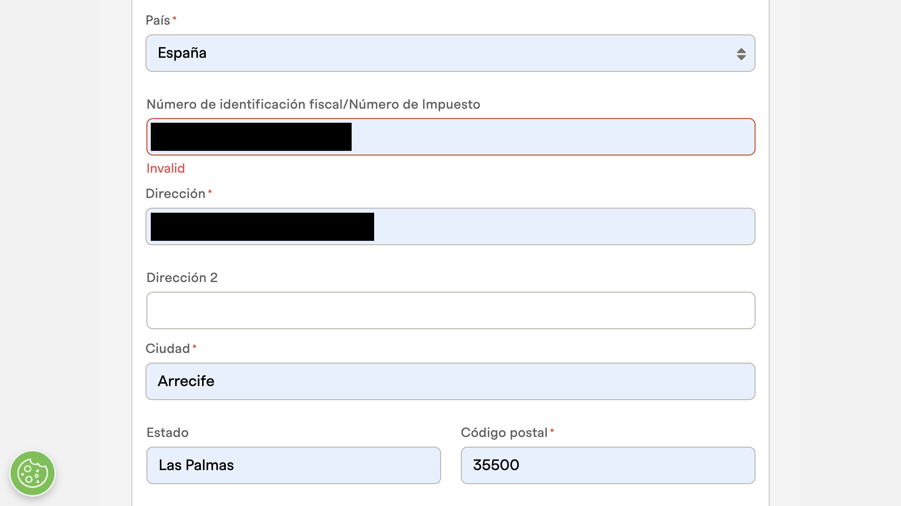
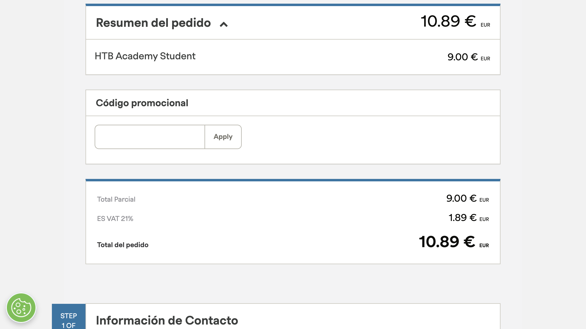
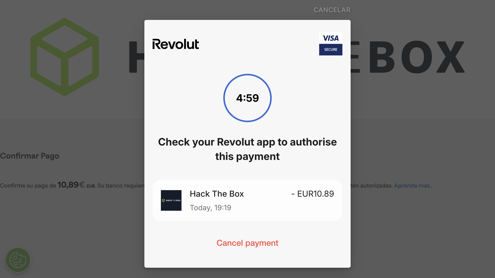
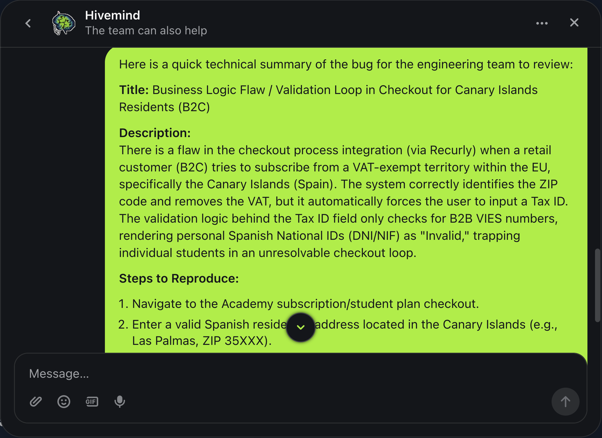
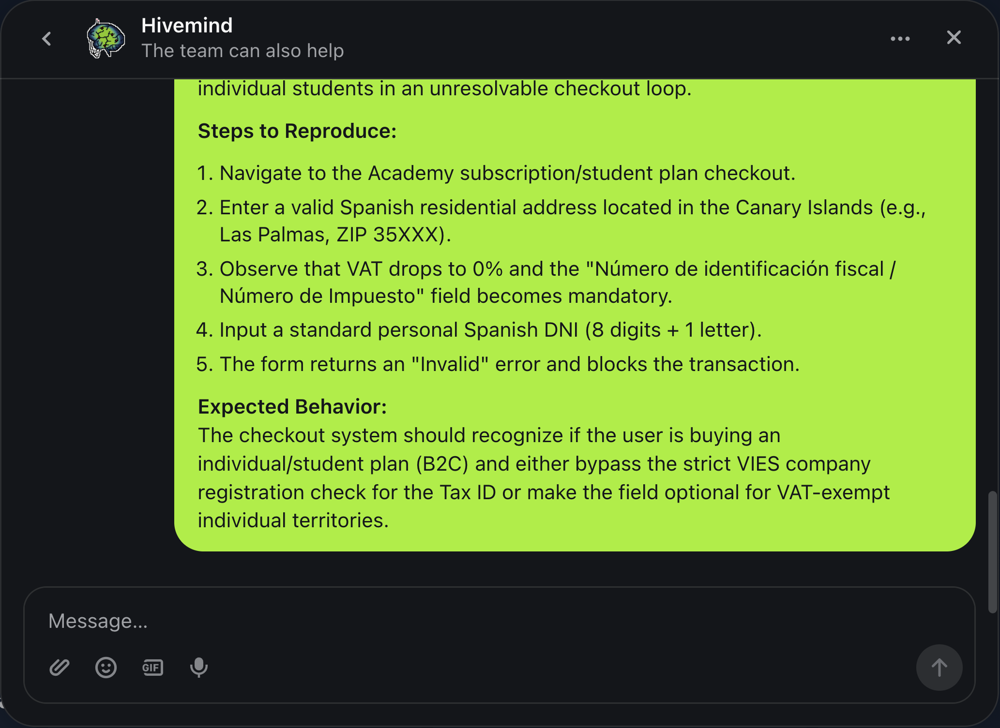
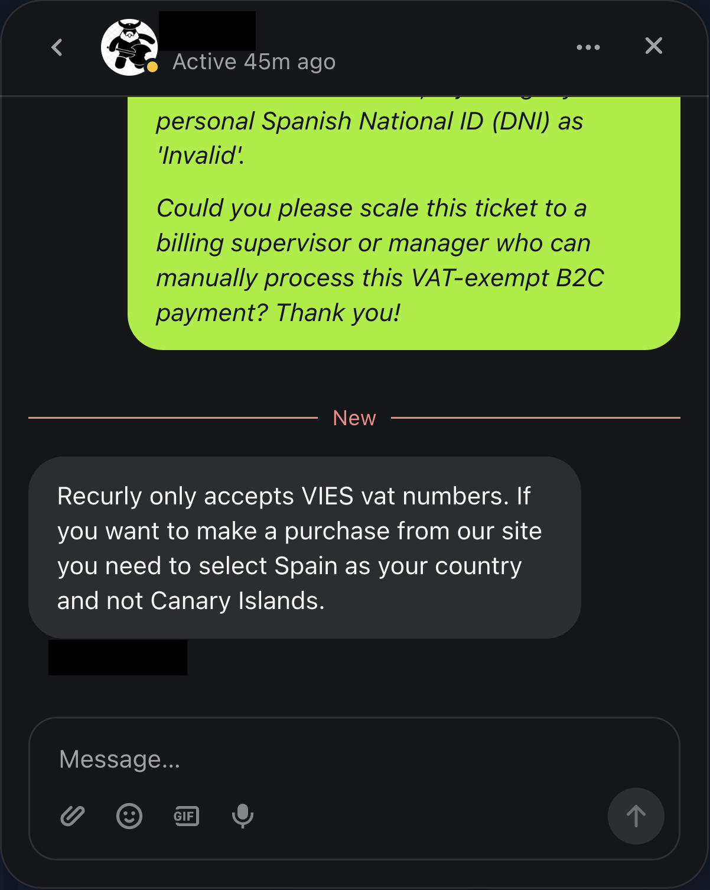
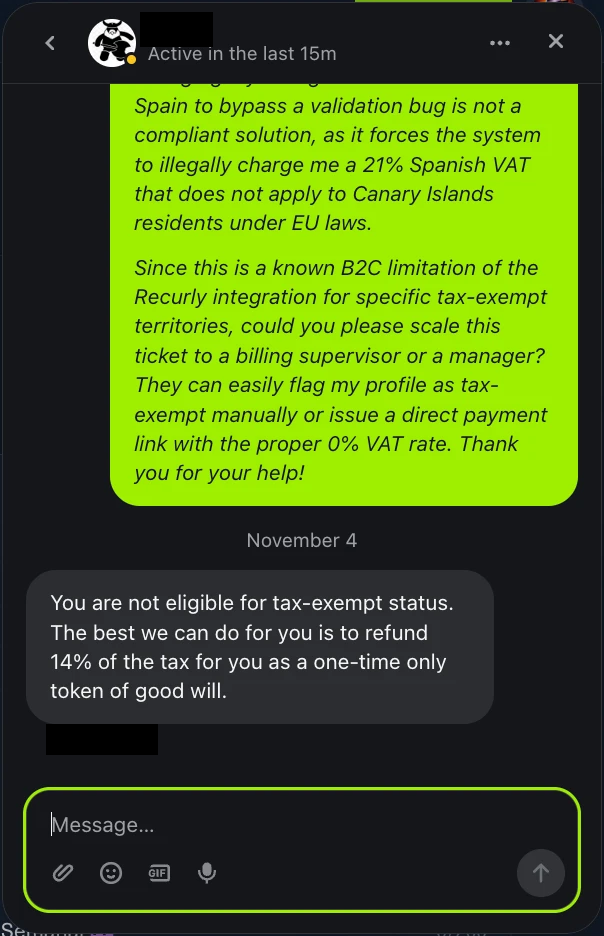

# Checkout de HTB Academy (Recurly): IVA y NIF para consumidores de Canarias

- **Fecha:** 3 de noviembre de 2026
- **Plataforma:** Hack The Box Academy (pagos con Recurly)
- **Tipo:** lógica de negocio / validación fiscal
- **Estado:** reportado al soporte de HTB el 3 de noviembre de 2026; la última respuesta recibida figura en la cronología

## Resumen

Al contratar el plan *HTB Academy Student* (9,00 €) con una dirección de Canarias, el checkout trata el campo del identificador fiscal de forma contradictoria. Si lo dejo vacío, avanza y aplica el IVA español del 21 %. Si introduzco el DNI de un particular, lo rechaza como `Invalid` y no me deja continuar. El soporte confirmó que el validador solo acepta números de IVA intracomunitarios (VIES) y me recomendó elegir España como país en lugar de Canarias. El 4 de noviembre respondió que no soy elegible para la exención y ofreció devolverme el 14 % del impuesto como gesto único de buena voluntad.

## Contexto

Hack The Box es una plataforma de práctica de ciberseguridad. Su suscripción de Academy se cobra con Recurly y el pago se autoriza con 3-D Secure en el banco. Encontré el comportamiento al intentar renovar mi suscripción como consumidor residente en Canarias.

## Cómo reproducirlo

1. Abrir el checkout del plan *HTB Academy Student* (importe base: 9,00 €).
2. Introducir una dirección de Canarias (provincia de Las Palmas, código postal 35xxx).
3. En *Número de identificación fiscal / Número de Impuesto*, introducir un DNI español de particular (8 dígitos y una letra). El formulario responde `Invalid` y bloquea el avance.

   

4. Repetir el proceso dejando ese campo vacío. El checkout continúa y aplica el IVA español.

   

   

El comportamiento exacto depende del orden en que se rellenan país, código postal e identificador fiscal. No he probado todas las combinaciones.

## Resultado observado

| Contenido del campo fiscal | Resultado |
|---|---|
| Vacío | El checkout avanza. Recurly aplica `ES VAT 21%` (1,89 €) sobre 9,00 € y cobra **10,89 €**. El importe aparece en el resumen y en la ventana de autorización de Revolut, pero el checkout no pide confirmar explícitamente el impuesto antes del cobro. |
| DNI de particular (B2C) | El formulario lo rechaza como `Invalid` y bloquea el avance. |

En el reporte que envié al soporte describí además que, al detectar el código postal canario, el checkout pone el IVA a 0 % y a continuación hace obligatorio el campo fiscal.

## Análisis

- **Lectura fiscal (mía, no es asesoramiento):** las Islas Canarias quedan fuera del territorio de aplicación del IVA de la UE (art. 6 de la Directiva 2006/112/CE). Por eso el recargo del 21 % no tendría base en el IVA comunitario para un consumidor canario.
- **Inconsistencia de diseño:** el sistema aplica el tratamiento fiscal por defecto cuando el dato falta, pero rechaza el dato cuando el usuario lo aporta. Un particular que deja el campo vacío paga un impuesto que el checkout no explica. Uno que aporta su DNI no puede completar el pago. Ningún camino permite comprar sin IVA desde Canarias como consumidor.
- **Hipótesis, sin verificar:** el validador solo acepta números VIES, pensados para empresas (B2B), por lo que descarta los identificadores de particulares. No tengo acceso al código ni al backend; solo he observado el comportamiento del navegador.

## Impacto

- **Afectados:** consumidores (B2C) con domicilio en Canarias que contratan Academy.
- **Efecto:** o pagan un IVA que, según mi lectura, no les corresponde, o no pueden completar la compra con su documento de identidad.
- **Valoración:** impacto económico y de usabilidad. No he identificado exposición de datos de terceros ni acceso no autorizado.

## Comunicación con el soporte

Registro de la conversación con el soporte de Hack The Box los días 3 y 4 de noviembre de 2026.

1. **Reporte inicial:** envié un resumen técnico con los pasos para reproducirlo y el comportamiento esperado.

   

   

2. **Primera respuesta del soporte:** un agente indicó que, como la norma ISO no reconoce las Islas Canarias como país, la región sigue perteneciendo a España y por eso se aplica la tarifa española.
3. **Mi réplica:** señalé que esa afirmación no es correcta respecto a la política fiscal de la UE (Canarias queda excluida del territorio de IVA). Indiqué también que el checkout reconoce el código postal canario y pone el IVA a 0 %, pero después obliga a introducir un NIF que rechaza para un DNI de particular. Pedí escalar el ticket a un responsable de facturación para procesar manualmente un pago B2C exento.
4. **Respuesta final del agente:** «Recurly only accepts VIES vat numbers» y, para comprar, «you need to select Spain as your country and not Canary Islands».

   

   Esa recomendación traslada el 21 % al usuario en lugar de corregir la validación, por lo que la considero una solución insatisfactoria para un consumidor canario.
5. **Mi segunda réplica y la respuesta del 4 de noviembre:** respondí que cambiar el país a España para esquivar un fallo de validación no es una solución conforme, porque obliga a cobrar un 21 % de IVA español que, según mi lectura, no se aplica a residentes en Canarias. Volví a pedir que escalaran el ticket a un responsable de facturación para marcar mi perfil como exento o emitir un enlace de pago con IVA 0 %. El agente contestó: «You are not eligible for tax-exempt status. The best we can do for you is to refund 14% of the tax for you as a one-time only token of good will» (no eres elegible para la exención; lo máximo que podemos hacer es devolverte el 14 % del impuesto como gesto único de buena voluntad).

   

   La respuesta no corrige la validación ni aclara por qué se aplica el IVA español a un consumidor canario: ofrece una devolución parcial puntual, que no resuelve el problema para los demás usuarios afectados.

## Recomendaciones

1. **Aceptar el DNI/NIF español para B2C**, o no exigir el campo cuando el IVA es 0 % y la compra no es B2B.
2. **Mostrar y confirmar de forma explícita los impuestos** antes de lanzar la autorización del pago.
3. **Mensajes de error accionables:** `Invalid` no indica qué formato se espera ni cómo continuar.
4. **Incluir en las pruebas de calidad los flujos B2C en territorios especiales** (Canarias, Ceuta y Melilla).

## Qué he aprendido

- Un fallo de lógica de negocio no es un error de programación clásico: cada regla funciona por separado, pero juntas dejan al usuario sin camino válido.
- Documentar bien un hallazgo exige separar lo observado de lo que supongo. Por eso las hipótesis sobre el validador van marcadas como no verificadas.
- Antes de publicar una evidencia hay que revisar lo que no es el hallazgo: barras del navegador, pestañas, datos personales y nombres de personas.

---

*Informe elaborado como parte de mi aprendizaje en ciberseguridad. Las capturas se obtuvieron en una interacción legítima con la plataforma, con fines educativos. Se han ocultado mis datos personales (DNI, dirección, correo) y el nombre del agente de soporte.*
